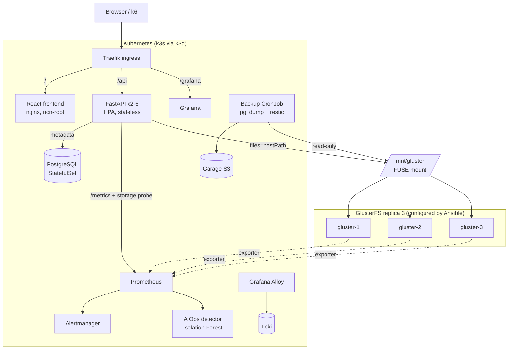
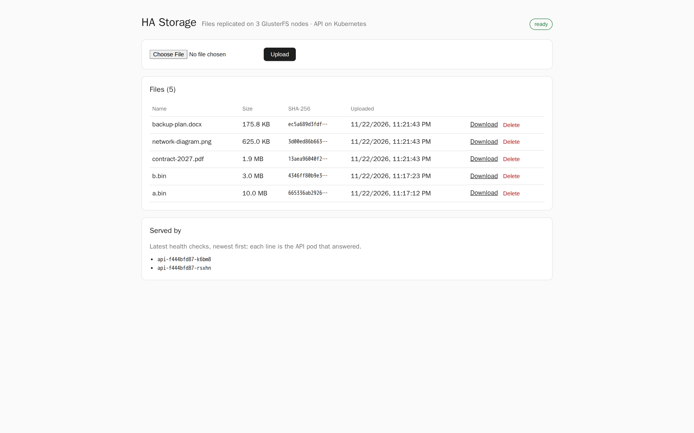
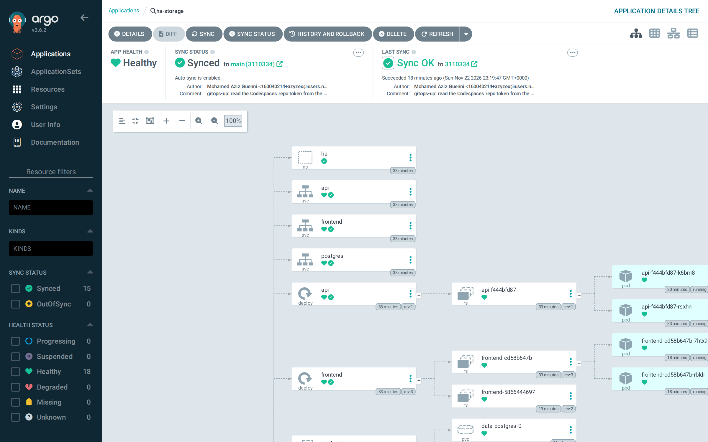
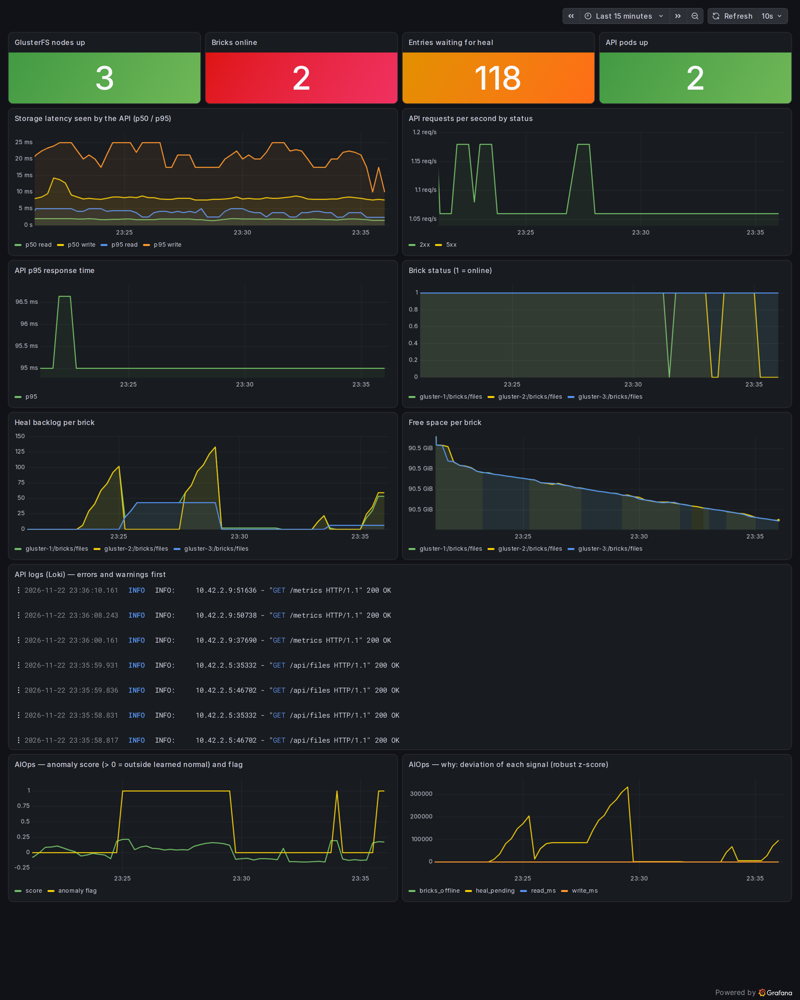
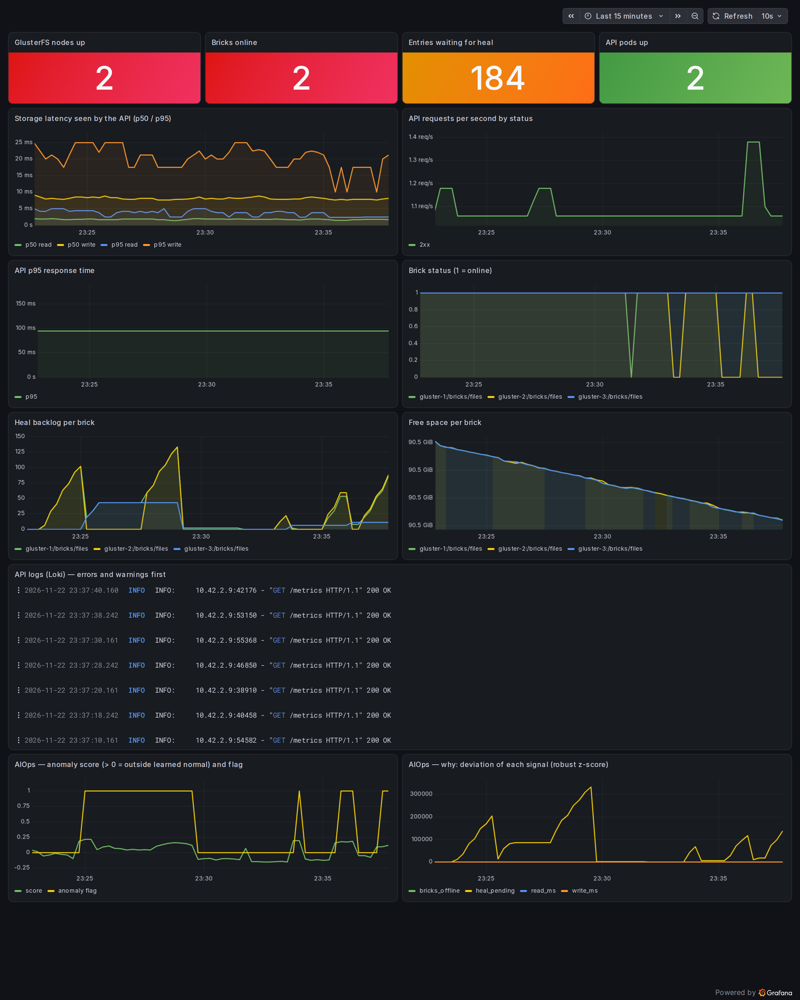
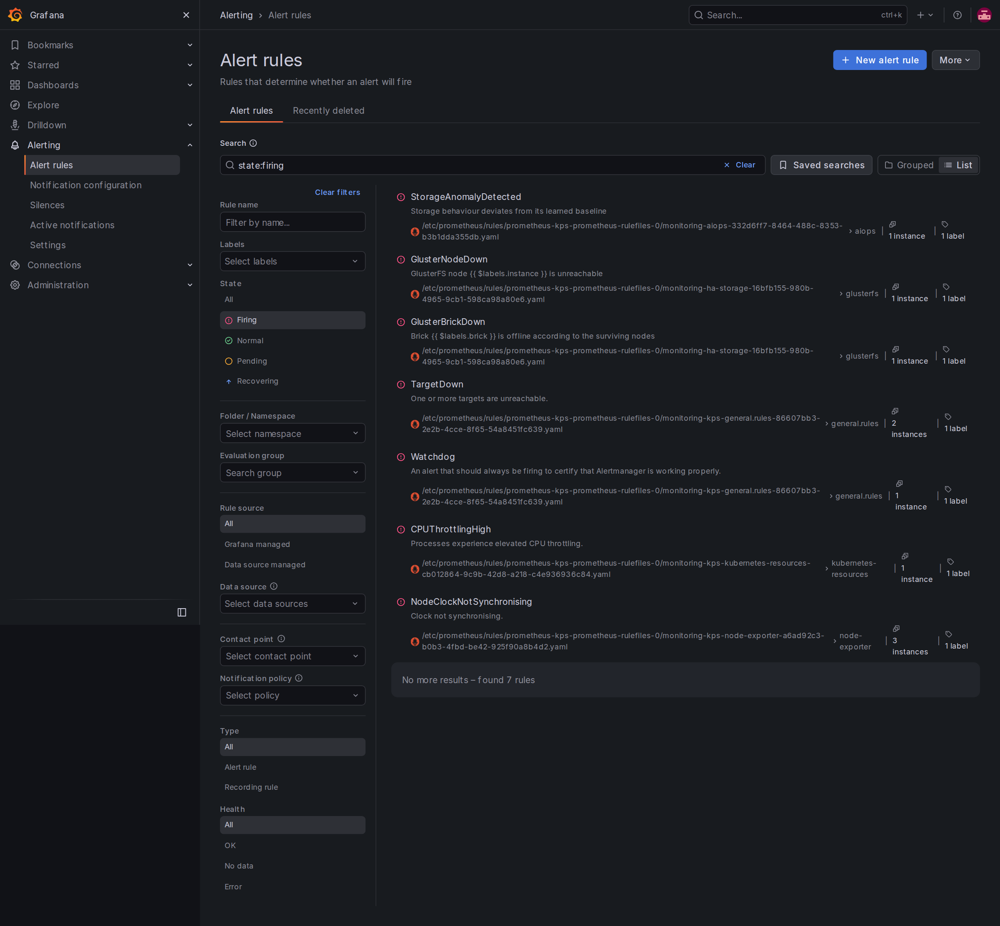

# HA Storage Platform

**A file-storage service that does not lose files and does not go down.** Files are replicated on a 3-node **GlusterFS** cluster, served by an app on **Kubernetes**, watched by **Prometheus / Grafana / Loki** and an **ML anomaly detector**, shipped through a **security-gated CI/CD pipeline**, kept in sync with Git by **Argo CD**, guarded at runtime by **Falco**, and backed up to **S3**. Every failure scenario below is executed automatically on every push.

## Architecture

**Design choices:** file bytes on GlusterFS, metadata in PostgreSQL (a distributed file system is a poor fit for database I/O) · GlusterFS runs next to Kubernetes and is bind-mounted into every node (Kubernetes removed its in-tree GlusterFS plugin in v1.26) · API pods are stateless, so they can be killed and scaled freely · replication **plus** backups, because a delete is replicated too.

## Measured results (from CI on a cloud runner)

| Scenario | Result |
|---|---|
| Storage node killed | file still served in **0.06-0.12 s**, identical SHA-256; new uploads accepted on 2 of 3 nodes |
| Node returns | **self-heal** copies the writes it missed |
| API pod killed while serving traffic | **0 failed requests** (preStop drain; 2/128 failed before adding it) |
| PostgreSQL pod deleted | metadata intact, API reconnects by itself |
| Random pod tries to reach PostgreSQL | **blocked** by NetworkPolicy; API-labelled pod allowed |
| Node killed → alert | `GlusterNodeDown` fires in **~36-48 s**, reaches Alertmanager, resolves ~15 s after recovery |
| Accidental delete (gone from all 3 replicas) | **restored from backup in 6 s**, checksum identical |
| Gray failure: one node slowed by 40 ms, still alive | writes 5 → 226 ms; **AI detector flagged it in ~45 s** and named the cause (write latency); the static 500 ms alert **did not fire** |
| 40 concurrent users + a storage node killed for 25 s | **11,482 requests, 0.01 % failed (~1 request), p95 0.71 s**; autoscaler **2 → 6 API pods**; the restarted node rejoins and fully heals |
| Manual changes to the cluster (deleted NetworkPolicy, scaled Deployment, disabled read-only filesystem) | **reverted by Argo CD in 2-4 s** |
| Shell opened inside an API container | **detected by Falco** instantly, pod identified |
| Trivy / gitleaks gates | caught real CVEs (CRITICAL in nginx base image, HIGH in python-multipart / starlette), fixed before merge; no secrets in history |

*Lab scale: all nodes are containers on one cloud machine. It demonstrates replication, failover, self-healing and the operations around them, not a multi-region production system.*

## Screenshots (live system, captured by `scripts/capture-screenshots.py`)

| | |
|---|---|
|  **Web app**: upload/download, SHA-256 per file, which API pod answered |  **Argo CD**: the platform deployed from Git, Synced/Healthy |
|  **Grafana, healthy**: 3 nodes, 3 bricks, storage latency, AIOps score |  **Grafana, gluster-2 stopped**: 2/3 nodes and bricks, heal backlog growing, anomaly flagged |

**Alerts during the failure**: GlusterNodeDown, GlusterBrickDown and the AIOps StorageAnomalyDetected fire together.

## What's inside

| Area | Tools |
|---|---|
| Storage | GlusterFS 11 (replica 3), custom Prometheus exporter |
| Configuration | Ansible (idempotent: second run changes nothing) |
| App | FastAPI, React + Vite, nginx, PostgreSQL 16 |
| Platform | Kubernetes (k3s / k3d), Traefik, HPA, NetworkPolicies, Docker |
| CI/CD | GitHub Actions: ruff, pytest, Bandit, gitleaks, Trivy (images + manifests), full end-to-end chaos tests |
| Observability | Prometheus, Alertmanager, Grafana (dashboard as code), Loki + Grafana Alloy |
| Backups | restic → Garage (S3-compatible), CronJob, restore drill |
| AIOps | scikit-learn Isolation Forest on storage telemetry, explains which signal moved |
| Load | k6 + chaos (node killed under load) |
| GitOps | Argo CD: Git is the source of truth; manual changes are reverted automatically |
| Runtime security | Falco (eBPF) with a custom rule for shells spawned inside app containers, Falcosidekick → Alertmanager |

## Run it (GitHub Codespaces)

1. **Code → Codespaces → Create codespace** (4-core / 16 GB machine; setup installs everything).
2. `make up` (about 10 minutes the first time)
3. Open the forwarded port **8080**: web app at `/`, Grafana at `/grafana` (`make password`).
4. `make demo`: narrated failure demo · `make test` · `make drill` · `make load` · `make down`

## Docs
[`docs/PLAN.md`](docs/PLAN.md): plan and design decisions · [`docs/STATUS.md`](docs/STATUS.md): progress log, including every bug the tests found · [`docs/INTERVIEW.md`](docs/INTERVIEW.md): how each part works, in plain words
